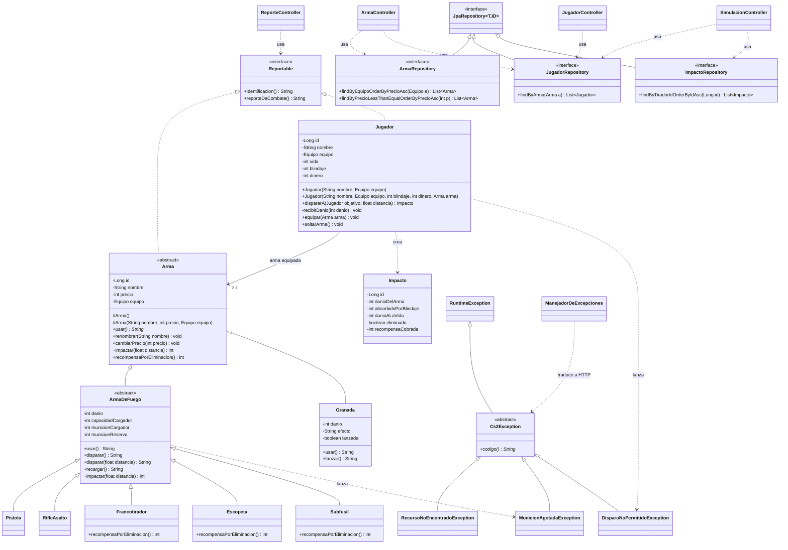

# jb-taller-git-2026

Servicio REST en Spring Boot (Java 21) con el modelado de armas de **Counter-Strike 2**, persistido en **H2**.
Lenguaje de Programación 3 (CYT646) — Universidad Católica «Nuestra Señora de la Asunción».
Autor: Joaquín Benegas ([@joaquinBenegas0](https://github.com/joaquinBenegas0)).

**Licencia:** [Apache License 2.0](LICENSE).

**Commit de la solución POO-08:** _(se completa con el enlace al commit de entrega)_

## Cómo arrancarlo

```
./mvnw spring-boot:run
```

El servicio queda en `http://localhost:8080`. Al arrancar, `DatosIniciales` carga una partida de ejemplo con los constructores del dominio, así que en una base recién creada los ids son siempre los mismos:

| id | Arma | Tipo | | id | Jugador | Equipo | Arma |
|---|---|---|---|---|---|---|---|
| 1 | AK-47 | rifle | | 1 | Sombra | TERRORISTAS (blindaje 0) | AK-47 |
| 2 | AWP | francotirador | | 2 | Halcón | ANTITERRORISTAS (blindaje 100) | AWP |
| 3 | Glock-18 | pistola | | 3 | Lince | ANTITERRORISTAS (blindaje 100) | USP-S (última bala) |
| 4 | Nova | escopeta | | 4 | Cuervo | TERRORISTAS (blindaje 0) | HE |
| 5 | MP9 | subfusil | | | | | |
| 6 | HE | granada | | | | | |
| 7 | USP-S (última bala) | pistola, cargador de 1 y sin reserva | | | | | |

Las pruebas de las dos reglas corren sin base ni Spring: `./mvnw test`.

## Propiedades de H2

En [`application.properties`](src/main/resources/application.properties):

| Propiedad | Qué hace |
|---|---|
| `spring.datasource.url=jdbc:h2:mem:cs2db;DB_CLOSE_DELAY=-1` | Base H2 en memoria llamada `cs2db`, dentro del mismo proceso Java; `DB_CLOSE_DELAY=-1` la mantiene viva mientras corra la aplicación. |
| `spring.datasource.username=sa` | Usuario de la base (el administrador por defecto de H2). |
| `spring.datasource.password=` | Contraseña vacía: es una base local de desarrollo. |
| `spring.datasource.driver-class-name=org.h2.Driver` | Driver JDBC que habla con H2. |
| `spring.jpa.hibernate.ddl-auto=create-drop` | Hibernate crea las tablas a partir de las entidades al arrancar y las borra al apagar: cada arranque empieza con la misma partida. |
| `spring.jpa.show-sql=true` | Muestra en la consola el SQL que genera Hibernate. |
| `spring.jpa.open-in-view=false` | La sesión de la base se cierra al terminar cada método del controller; la vista no sigue haciendo consultas. |
| `spring.h2.console.enabled=true` | Habilita la consola web de H2. |
| `spring.h2.console.path=/h2-console` | Dirección de la consola. |

**Consola H2:** abrir `http://localhost:8080/h2-console`, poner JDBC URL `jdbc:h2:mem:cs2db`, usuario `sa`, contraseña vacía y *Connect*. Ahí se ven las tablas `ARMA`, `JUGADOR` e `IMPACTO` (por ejemplo `SELECT * FROM ARMA;`).

Para que los datos sobrevivan a un reinicio alcanza con cambiar la URL a `jdbc:h2:file:./data/cs2db` y `ddl-auto` a `update` (y agregar `data/` al `.gitignore`).

## Endpoints

| Método y ruta | Qué hace | Éxito |
|---|---|---|
| `GET /` | Confirma que el servicio está vivo | 200 |
| `GET /api/armas` | Lista las armas guardadas (`?equipo=TERRORISTAS` o `?precioMaximo=1000` usan consultas del repositorio) | 200 |
| `GET /api/armas/{id}` | Un arma, o 404 | 200 |
| `POST /api/armas` | Crea un arma; el JSON lleva `"tipo"` y no lleva `id` | 201 |
| `PATCH /api/armas/{id}` | Cambia `nombre` y/o `precio` | 200 |
| `DELETE /api/armas/{id}` | La tienda retira el arma; quien la tenía la suelta | 204 |
| `GET /api/jugadores`, `GET /api/jugadores/{id}`, `POST /api/jugadores` | Jugadores de la partida | 200 / 201 |
| `GET /api/reportes` | Usa la interfaz `Reportable` con armas y jugadores | 200 |
| `POST /api/simulaciones/disparos` | Simula un disparo y guarda el resultado | 201 |
| `GET /api/simulaciones/disparos` | Historial persistido de disparos (`?tiradorId=1` filtra) | 200 |
| `GET /api/armas/inventario`, `GET /api/armas/francotirador?...` | Endpoints de POO-04 y POO-06 (sin persistencia) | 200 |

Ejemplos de JSON de creación:

```json
{ "tipo": "rifle", "nombre": "M4A4", "precio": 3100, "equipo": "ANTITERRORISTAS" }
{ "tipo": "granada", "nombre": "Flashbang", "precio": 200, "equipo": "ANTITERRORISTAS", "efecto": "ceguera temporal" }
{ "tiradorId": 1, "objetivoId": 2, "distancia": 20 }
```

Los valores de `tipo` son `pistola`, `rifle`, `francotirador`, `escopeta`, `subfusil` y `granada`. Si en `pistola`, `rifle` o `francotirador` se omiten `danio` y compañía, se usa el constructor simple con los valores estándar de CS2.

## Las dos reglas del juego

Participan tres clases persistidas: la familia **`Arma`** (con `ArmaDeFuego` y `Granada` como hijas), **`Jugador`** e **`Impacto`**.

1. **Munición:** cada disparo de un `ArmaDeFuego` gasta del cargador las balas de su modo de disparo (5 un `RifleAsalto` en automático) y con el cargador vacío no se dispara (`MunicionAgotadaException`).
2. **Daño con blindaje:** el blindaje del `Jugador` objetivo absorbe hasta la mitad del daño y el resto baja la vida; si la vida llega a 0 queda eliminado y el tirador cobra la recompensa de su arma ($300 de base, $100 el francotirador, $600 el subfusil, $900 la escopeta), sin pasar de $16 000.

`POST /api/simulaciones/disparos` dispara `Jugador.dispararA(objetivo, distancia)`, que aplica las dos reglas y devuelve un `Impacto`; el controller guarda el arma, los dos jugadores y el impacto en una sola transacción. Ejemplo con la partida inicial: Sombra (AK-47) le dispara a Halcón a 20 m → el AK-47 gasta 5 balas (30 → 25) y hace 180 de daño; el blindaje de Halcón absorbe 90 (100 → 10) y su vida baja 90 (100 → 10). Un segundo disparo lo elimina y Sombra pasa de $800 a $1100. Un `GET /api/jugadores/2` y un `GET /api/armas/1` muestran ese estado ya guardado.

## Excepciones

| Clase | Hereda de | Quién la lanza | HTTP |
|---|---|---|---|
| `Cs2Exception` (abstracta) | `RuntimeException` | nadie directamente | — |
| `RecursoNoEncontradoException` | `Cs2Exception` | los controllers, cuando el repositorio no encuentra el id | 404 |
| `MunicionAgotadaException` | `Cs2Exception` | `ArmaDeFuego.impactar` (regla 1) | 409 |
| `DisparoNoPermitidoException` | `Cs2Exception` | `Jugador.dispararA` y `Arma.impactar` (regla 2) | 422 |
| `IllegalArgumentException` (de Java) | — | los constructores y mensajes que validan invariantes | 400 |

`ManejadorDeExcepciones` (`@RestControllerAdvice`) tiene un método `@ExceptionHandler` por tipo; cada uno fija su código con `@ResponseStatus`. El JSON de error siempre tiene la misma forma, así que el cliente distingue a las hermanas por `status`, `codigo` y `excepcion`:

```json
{ "status": 409, "codigo": "MUNICION_AGOTADA", "excepcion": "MunicionAgotadaException",
  "mensaje": "USP-S (última bala) tiene el cargador vacío (reserva: 0): hay que recargar antes de disparar" }
```

Las excepciones viven en `py.edu.uc.lp3exceptions`, el mismo paquete que usa el template de la cátedra.

## Paquetes

Siguen el [template de la cátedra](https://github.com/alefq/lp3-template-tp/tree/main/src/main/java/py/edu/uc/lp3):

```
src/main/java/py/edu/uc/
├── lp3/
│   ├── Application.java         solo arranca el servicio
│   ├── config/DatosIniciales     partida de ejemplo al arrancar
│   ├── constants/ApiPaths        rutas de la API
│   ├── domain/                   modelo de CS2, entidades JPA y reglas del juego
│   ├── repository/               interfaces de Spring Data (sin lógica)
│   └── rest/
│       ├── controller/           entrada HTTP y ManejadorDeExcepciones
│       └── dto/                  JSON de entrada (NuevaArma, CambioDeArma, NuevoJugador, DisparoSimulado)
└── lp3exceptions/                jerarquía de excepciones del dominio
```

## Diagrama de clases



Cómo leerlo:

- **Herencia** (`<|--`, flecha llena): `ArmaDeFuego` y `Granada` *son* `Arma`; las cinco armas de fuego *son* `ArmaDeFuego`.
- **Implementación de interfaz** (`<|..`, flecha punteada con triángulo): `Arma` y `Jugador`, de familias distintas, cumplen el protocolo `Reportable`.
- **Uso del repositorio** (`..>` "usa"): los controllers dependen de las interfaces `ArmaRepository`, `JugadorRepository` e `ImpactoRepository`, que extienden `JpaRepository`; Spring genera las implementaciones.
- **Jerarquía de excepciones** (`<|--` desde `Cs2Exception`): una base abstracta y tres hijas; dos de ellas llevan el nombre de una regla del juego.

## Sobrecarga y sobreescritura

**Sobrecarga** (misma clase, mismo nombre, otra lista de argumentos; Java elige la versión al compilar según los argumentos):

- **Constructores:** `Francotirador(nombre, precio)`, `Francotirador(nombre, precio, equipo)` y el completo; `RifleAsalto` y `Pistola` suman `(nombre, precio, equipo)`; `Granada(…, int danio)` arma una granada explosiva y `Granada(…, String efecto)` una táctica no letal. Las versiones cortas encadenan con `this(...)` hasta el constructor completo, que llama a `super` y valida: toda firma deja el objeto en un estado legal.
- **Mensaje del dominio:** `ArmaDeFuego.disparar()` y `ArmaDeFuego.disparar(float distanciaMetros)`. Es la misma acción; la segunda indica la distancia y, si supera el alcance efectivo, el daño cae en proporción. Las dos pasan por un único método privado que descuenta munición, así que ninguna puede saltarse esa regla.

**Sobreescritura** (misma firma en la clase hija, implementación propia; Java elige la versión al ejecutar según el objeto real):

- `Arma.usar()` es **abstracto**: el padre no puede resolverlo porque cada tipo se usa distinto. Lo sobreescriben dos hijas independientes: `ArmaDeFuego.usar()` dispara y `Granada.usar()` se lanza. `InventarioController` recorre una `List<Arma>` y llama a `usar()` sin ningún `if` por tipo.
- `alcanceEfectivo()` (nuevo): `ArmaDeFuego` define 50 m; `Escopeta` lo sobreescribe con su distancia efectiva y `Francotirador` lo multiplica por el zoom llamando a `super`.
- `balasPorDisparo()` (`Pistola`, `RifleAsalto`) y `calcularDanioPorBala()` (`Francotirador`, `Escopeta`) siguen especializando el disparo.

En resumen: la sobrecarga cambia **qué argumentos** recibe un mensaje dentro de una clase; la sobreescritura cambia **cómo responde** cada tipo al mismo mensaje.

- **Nuevo en POO-08:** `recompensaPorEliminacion()` se sobreescribe en `Francotirador`, `Escopeta` y `Subfusil`; `impactar(float)` está en `Arma` (no dispara) y `ArmaDeFuego` lo sobreescribe (gasta balas); `reporteDeCombate()` está en `Arma` y `ArmaDeFuego` lo sobreescribe sumando la munición. `Jugador` tiene dos constructores sobrecargados.

## Qué hay que pensar

**Recurso y verbo.** El sustantivo principal es *arma* (`/api/armas`); también hay *jugadores* y *disparos* de la simulación (`/api/simulaciones/disparos`). La URL nombra el recurso y el verbo dice la operación: `POST` crea, `GET` lee, `PATCH` cambia, `DELETE` borra. Disparar es crear un recurso nuevo (un `Impacto`), por eso es un `POST` a la colección de disparos y no un verbo en la URL.

**Identidad.** La clave es `id` (`Long`) y la asigna H2 con `GenerationType.IDENTITY`. El JSON de creación no la lleva: los records de `NuevaArma` ni siquiera tienen ese campo. La respuesta del `POST` sí la trae.

**Herencia y tablas.** Usamos `SINGLE_TABLE`: toda la familia `Arma` vive en la tabla `ARMA` y la columna `TIPO` dice qué clase es cada fila. En nuestro dominio las armas comparten casi todo (nombre, precio, equipo, munición) y el inventario y los reportes siempre piden "todas las armas", así que una sola tabla evita los `JOIN` de `JOINED` y las uniones de `TABLE_PER_CLASS`. El costo es que las columnas propias de cada hija (por ejemplo `ZOOM`) quedan en `NULL` en las filas de las demás. En el JSON el subtipo viaja en la propiedad `"tipo"`: Jackson la escribe al listar (`@JsonTypeInfo` y `@JsonSubTypes` en `Arma`) y la lee al crear (lo mismo en `NuevaArma`). Elegimos un nombre lógico (`"rifle"`) y no el nombre de la clase Java, para que renombrar una clase no rompa a los clientes.

**Interfaz y repositorio.** El controller depende de `ArmaRepository`, una interfaz: no sabe si detrás hay H2, PostgreSQL o un doble de prueba, y Spring le inyecta la implementación que generó. Es lo mismo que el protocolo de POO-07: quien usa `Reportable` no sabe qué clase concreta tiene enfrente, solo qué mensajes entiende. Si mañana cambiamos H2 por otra base, se tocan `pom.xml` y `application.properties`; el dominio, los repositorios y los controllers se quedan quietos.

**Protocolo del dominio.** La interfaz es `Reportable` (`identificacion()` y `reporteDeCombate()`). La implementan `Arma` (y por herencia todas las armas) y `Jugador`, dos familias distintas. La usa `GET /api/reportes`: junta armas y jugadores en una `List<Reportable>` y les manda el mismo mensaje; `ArmaDeFuego` responde con su munición y `Jugador` con su vida, blindaje y dinero.

**Ocultamiento.** Las reglas numéricas las sostienen las clases del dominio: no hay setters, los constructores y los mensajes (`cambiarPrecio`, `dispararA`, `impactar`) validan, y `recibirDanio` y `cobrarRecompensa` son privados. JPA necesita un constructor sin argumentos, pero lo dejamos `protected`: Hibernate lo puede usar y el controller no. JPA escribe los campos por reflexión (acceso por campo), así que tampoco hizo falta abrir setters. El pedido de Insomnia *POST ilegal: precio negativo* devuelve 400 y *Listar armas: la colección no creció* muestra la misma cantidad que antes: el constructor rechaza el arma antes de que exista, y como el `POST` es transaccional no se guarda nada.

**PUT y PATCH.** Usamos `PATCH`: cambia un subconjunto (`nombre`, `precio`) y un campo omitido queda como estaba. No ofrecemos `PUT` porque reemplazar el recurso entero permitiría reescribir la munición o el estado de una granada, que solo deben cambiar con mensajes del juego (disparar, recargar, lanzar).

**DELETE.** Borrar es que la tienda retira el arma: se elimina la fila. Antes, los jugadores que la tenían equipada reciben el mensaje del dominio `soltarArma()`, así ninguno queda apuntando a un arma que no existe. Los `Impacto` guardan el nombre y el id del arma como datos, no como relación, así el historial no se pierde. Responde 204, y un `GET` posterior da 404.

**Dos reglas.** Un disparo cambia tres objetos a la vez: el arma (munición), el objetivo (blindaje y vida) y el tirador (dinero si elimina). El recurso HTTP es `/api/simulaciones/disparos`; cada `POST` deja un `Impacto` guardado, y un `GET /api/jugadores/{id}` o `GET /api/armas/{id}` posterior muestra el estado ya persistido.

**Excepciones.** La base es `Cs2Exception`; las hijas son `RecursoNoEncontradoException`, `MunicionAgotadaException` y `DisparoNoPermitidoException`, nombradas por lo que falló. Un recurso inexistente (404) y una regla incumplida (409/422) son tipos distintos: el primero lo detecta el controller al no encontrar el id; las otras dos las lanza el objeto del juego. El JSON de error lleva `status`, `codigo`, `excepcion` y `mensaje`. Son **no comprobadas** (`RuntimeException`): ningún método intermedio puede arreglar un cargador vacío, así que no tiene sentido obligar a cada firma a declarar `throws`; además Spring revierte la transacción por defecto ante una excepción no comprobada, que es justo lo que queremos cuando la regla falla.

## Colección de Insomnia

Archivo: [`insomnia/jb-taller-git-2026-poo08.json`](insomnia/jb-taller-git-2026-poo08.json).

1. Arrancar el servicio con `./mvnw spring-boot:run` (base recién creada).
2. En Insomnia: *Import* → *From File* → elegir el JSON. Se crea la colección **jb-taller-git-2026 · POO-08 CS2** con su entorno (`base_url` = `http://localhost:8080`, `arma_creada_id` = 8).
3. Recorrer las carpetas en orden:
   - **0. Servicio vivo:** `GET /`.
   - **1. CRUD de armas:** listar → crear el M4A4 (201; copiar el `id` de la respuesta en `arma_creada_id` si no es 8) → ver → PATCH del precio → ver que quedó → crear una flashbang → DELETE (204) → GET del borrado (404).
   - **2. POST ilegal e id inexistente:** precio negativo, cargador 0 y tipo desconocido (400) → listar y ver que la colección no creció → GET y DELETE del id 999 (404).
   - **3. Interfaz Reportable:** `GET /api/reportes`.
   - **4. Jugadores:** listar, crear uno y un blindaje ilegal (400).
   - **5. Simulación:** Sombra le dispara a Halcón → ver Halcón y el AK-47 → segundo disparo (eliminación) → ver el dinero de Sombra → historial.
   - **6. Una excepción de cada tipo:** tirador 999 (404, `RecursoNoEncontradoException`) → Lince gasta su única bala (201) → Lince otra vez (409, `MunicionAgotadaException`) → fuego amigo y disparo con granada (422, `DisparoNoPermitidoException`).

Para repetir el recorrido desde cero, se reinicia el servicio (la base es en memoria).

## Bitácora de IA

Ver [BITACORA.md](BITACORA.md).
