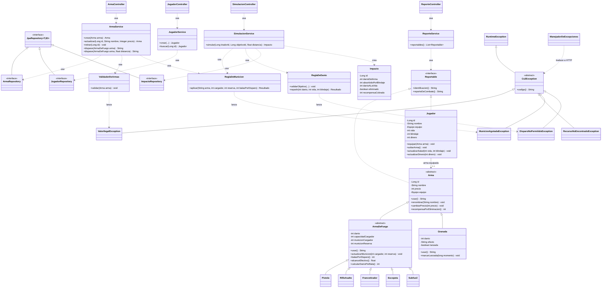

# jb-taller-git-2026

Servicio REST en Spring Boot (Java 21) con el modelado de armas de **Counter-Strike 2**, persistido en **H2**.
Lenguaje de Programación 3 (CYT646) — Universidad Católica «Nuestra Señora de la Asunción».
Autor: Joaquín Benegas ([@joaquinBenegas0](https://github.com/joaquinBenegas0)).

**Licencia:** [Apache License 2.0](LICENSE).

**Commit de la solución POO-08:** [c090137026e92410bd4fb4ddb73d99561a40ce6e](https://github.com/joaquinBenegas0/jb-taller-git-2026/commit/c090137026e92410bd4fb4ddb73d99561a40ce6e)

**Commit de la solución POO-09:** _(se completa con el enlace al commit de entrega)_

## POO-09 · Challenge de APIs cruzadas

### Situación de POO-08

POO-08 tuvo **21,5 / 24** (corrección del 8 de noviembre sobre el commit `c090137`). Las tres observaciones quedaron cerradas:

| Criterio | Observación | Cómo se cerró |
|---|---|---|
| 2. Paquetes (1/3) | Las transacciones y la lógica estaban en los controllers, que además recibían los repositorios. | Nueva capa `py.edu.uc.lp3.service`: `ArmaService` (`crear`, `actualizar`, `retirar`, `disparar`), `JugadorService`, `SimulacionService` (`simular(tiradorId, objetivoId, distancia)`) y `ReporteService`, con `@Transactional`. Son los únicos que usan `ArmaRepository`, `JugadorRepository` e `ImpactoRepository`; los controllers solo reciben el pedido, llaman al service y devuelven la respuesta. |
| 2. Paquetes (−1) | El dominio lanzaba excepciones y tenía lógica de negocio. | Las entidades (`Arma` y sus hijas, `Jugador`, `Impacto`) ya no lanzan ninguna excepción ni aplican reglas: solo guardan estado. Las validaciones están en `ValidadorDeArmas` y `JugadorService`, y las dos reglas en `ReglaDeMunicion` y `ReglaDeDanio` (service), que lanzan `ValorIlegalException` (nueva hija de `Cs2Exception`), `MunicionAgotadaException` y `DisparoNoPermitidoException`. |
| 8. Documentación (2,5/3) | Faltaba el enlace al commit en el README. | El enlace de POO-08 está arriba, con el hash completo. |

Las pruebas (`./mvnw test`) ahora prueban las reglas en los services, con repositorios de Mockito.

### Mapa del grupo (Counter-Strike 2, trío)

| Rol | Integrante | Repositorio | URL base | OpenAPI | Reglas que publica |
|---|---|---|---|---|---|
| **A1** | Joaquín Benegas (`joaquinBenegas0`) | [jb-taller-git-2026](https://github.com/joaquinBenegas0/jb-taller-git-2026) | `http://localhost:8083` | `/v3/api-docs` · `/swagger-ui.html` | Munición (`POST /api/reglas/municion`) y daño con blindaje (`POST /api/reglas/danio`) |
| **A2** | Matías José Jara García (`Vanzfranhait`) | [mj-taller-git-2026](https://github.com/Vanzfranhait/mj-taller-git-2026) (commit [`7e4c53a`](https://github.com/Vanzfranhait/mj-taller-git-2026/commit/7e4c53a083e98007532e229f523279be1e039159)) | `http://localhost:8080` | `/v3/api-docs` · `/swagger-ui.html` | Explosión de granada y disparo rápido de francotirador (`POST /api/reglas/disparo-rapido`) |
| **A3** | Marcelo Kropff (`Pomona06`) | [MK-taller-git-2026](https://github.com/Pomona06/MK-taller-git-2026) | `http://localhost:8082` | `/v3/api-docs` · `/swagger-ui.html` | Munición (`/api/reglas/disparo`, `/api/reglas/recarga`) y vida (`/api/reglas/impacto`) |

Puertos acordados en el grupo para correr los tres en una sola máquina: Matías 8080, Marcelo 8082 y Joaquín 8083.

Round robin: Joaquín consulta a Matías y a Marcelo; Matías consulta a Marcelo y a Joaquín; Marcelo consulta a Joaquín y a Matías. Los tres README tienen que listar las mismas tres URLs.

**Reglas que uso de cada compañero:**

- **A2 · Matías, disparo rápido de francotirador** ([README](https://github.com/Vanzfranhait/mj-taller-git-2026#dos-reglas)): un francotirador con estabilidad mayor a 0.7 puede hacer un disparo rápido que gasta 2 balas, y si no está estabilizado o tiene menos de 2 balas la regla lo rechaza (`ReglaDeJuegoException`, 400). Lo consulto en `POST /api/reglas/disparo-rapido` con `estabilidad` y `municionActual`: responde 200 `{"permitido":true,"municionDespues":3,"estabilidadDespues":0.5}` o 400 `{"error":"regla_de_juego","mensaje":"..."}`, y no modifica su H2.
- **A3 · Marcelo, vida** ([ficha para el grupo](https://github.com/Pomona06/MK-taller-git-2026/blob/main/docs/PARA-COMPANEROS.md)): el daño baja con la distancia, el chaleco desvía una parte y un jugador con vida 0 ya está eliminado y no recibe más daño (`JugadorEliminadoException`, 409). Lo consulto en `POST /api/reglas/impacto` con `modelo`, `distancia`, `vida` y `blindaje`.

**Mis reglas, tal como las consultan ellos:**

- **Munición** (`POST /api/reglas/municion`): un disparo gasta las balas de su modo (SEMI 1, RAFAGA 3, AUTOMATICO 5) sin pasarse de las que quedan; con el cargador vacío responde 409 `MUNICION_AGOTADA`.
- **Daño con blindaje** (`POST /api/reglas/danio`): solo se le dispara a un enemigo vivo (si no, 422 `DISPARO_NO_PERMITIDO`); el blindaje absorbe hasta la mitad del daño y el resto baja la vida, que nunca queda negativa.

Las dos no tocan mi base: un compañero las puede llamar con los datos de su propia partida.

### El escenario: disparo rápido con francotirador

**En una frase:** un jugador de mi partida hace un disparo rápido (dos balas de una vez) con su francotirador, y la jugada solo se guarda en mi H2 si la regla de disparo rápido de A2 dice que está estabilizado y tiene dos balas, y la regla de vida de A3 dice que el objetivo puede recibir el impacto.

`POST /api/escenarios/disparos-rapidos` con `{ "tiradorId": 2, "objetivoId": 1, "distancia": 40, "aguantaRespiracion": true }`:

1. `EscenarioService` busca en mi base al tirador, al objetivo y el francotirador equipado. Si el tirador no tiene francotirador, la jugada ni se arma: 422 propio, sin consultar a nadie.
2. **A2 primero (Matías):** le pregunta si el francotirador puede hacer el disparo rápido. La estabilidad sale de la jugada: 1.0 si aguanta la respiración, 0.5 si no, como en el modelo de Matías. La munición es la del cargador. Va primero porque sin estabilidad o sin dos balas el disparo no existe y no tiene sentido preguntarle a A3 por un impacto que no va a ocurrir.
3. **A3 después (Marcelo):** le pregunta qué le hace ese disparo al objetivo (`modelo` del arma en su catálogo de CS2, `distancia`, `vida`, `blindaje`).
4. **Si los dos aceptan,** `RegistroDeJugadas` aplica el disparo rápido en mi partida (`SimulacionService.simularDisparoRapido`: mis dos reglas con 2 balas) y guarda, en una sola transacción, el `Impacto` y una `JugadaCruzada` con la estabilidad y lo que respondió cada compañero. Responde 201, y `GET /api/escenarios/disparos-rapidos` la muestra.
5. **Si alguno rechaza,** no se llega a tocar la base (las llamadas HTTP van antes de la transacción) y responde 422 diciendo quién fue:

```json
{ "status": 422, "codigo": "RECHAZO_DE_A3", "excepcion": "RechazoDeCompaneroException",
  "mensaje": "La jugada la rechazó A3 (Marcelo Kropff (Pomona06)) con HTTP 409",
  "rechazadoPor": "A3", "companero": "Marcelo Kropff (Pomona06)", "statusDelCompanero": 409,
  "respuestaDelCompanero": { "error": "El jugador ya está eliminado y no puede recibir más daño",
                             "excepcion": "JugadorEliminadoException" } }
```

**Qué queda en mi base después del éxito:** el francotirador con dos balas menos, el objetivo con menos vida (y el tirador con la recompensa, si lo eliminó), un `Impacto` nuevo y una `JugadaCruzada` que lo referencia.

**Si A2 acepta y A3 rechaza:** todo queda igual. La AWP conserva sus balas, el objetivo su vida y no se crean `Impacto` ni `JugadaCruzada`. En Insomnia, *Después: la AWP sigue con 3 balas* y *Después: sigue 1 jugada* lo muestran.

### Cliente HTTP

`DisparoRapidoDeA2` e `ImpactoDeA3` (paquete `py.edu.uc.lp3.cliente`) usan `RestClient` a través de `ClienteDeCompanero`, con 3 s de espera para conectar y 5 s para responder. Arman el JSON con los nombres de campo que publica el OpenAPI de cada compañero. No comparten ninguna clase con sus proyectos: no se clonó su código. Para A3, el modelo es el nombre de mi arma sin lo que va entre paréntesis (`"USP-S (última bala)"` → `"USP-S"`), que es como figura en el catálogo de Marcelo.

URL y ruta salen de `application.properties` y se pueden pisar con variables de entorno:

| Propiedad | Variable | Por defecto |
|---|---|---|
| `companeros.a2.url` | `A2_URL` | `http://localhost:8080` |
| `companeros.a2.ruta-disparo-rapido` | `A2_RUTA` | `/api/reglas/disparo-rapido` |
| `companeros.a3.url` | `A3_URL` | `http://localhost:8082` |
| `companeros.a3.ruta-impacto` | `A3_RUTA` | `/api/reglas/impacto` |

**Errores:** no se reenvía tal cual el código del compañero. Se traduce a mi jerarquía (`Cs2Exception`):

- `RechazoDeCompaneroException`: el compañero respondió 4xx, o sea que su regla rechazó (Matías responde 400 y Marcelo 409). 422 con `rechazadoPor` (A2 o A3), `statusDelCompanero` y `respuestaDelCompanero`.
- `CompaneroNoDisponibleException`: no respondió, se pasó del tiempo o dio 5xx. 503 con código `A2_NO_DISPONIBLE` o `A3_NO_DISPONIBLE`.

El handler distingue a A2 de A3 por el rol que lleva cada excepción.

**Pregunta ancla:** si un compañero renombra una ruta, alcanza con leer su OpenAPI nuevo y cambiar `A2_RUTA` / `A3_RUTA` (o la propiedad), sin tocar código. Si cambia un nombre de campo, se toca solo `DisparoRapidoDeA2` o `ImpactoDeA3`. No se copió nada de su dominio.

### Cómo arrancar los tres servicios

**En una sola máquina** (tres terminales, cada repo en su commit de entrega):

```
git clone https://github.com/Pomona06/MK-taller-git-2026.git
cd MK-taller-git-2026 && ./mvnw spring-boot:run -Dspring-boot.run.arguments=--server.port=8082
```
```
git clone https://github.com/Vanzfranhait/mj-taller-git-2026.git
cd mj-taller-git-2026 && ./mvnw spring-boot:run
```
```
cd jb-taller-git-2026 && ./mvnw spring-boot:run -Dspring-boot.run.arguments=--server.port=8083
```

Orden: primero A2 y A3, después A1 (A1 arranca igual sin ellos, pero el escenario responde 503 hasta que estén). Mi servicio también acepta `PORT=8083 ./mvnw spring-boot:run`. Sin argumentos arranca en el 8080. La colección de Insomnia ya trae estos tres puertos en su entorno.

**En las notebooks del laboratorio:** cada uno arranca en su 8080 y A1 apunta a las IP de los otros:

```
A2_URL=http://IP_MATIAS:8080 A3_URL=http://IP_MARCELO:8080 ./mvnw spring-boot:run
```

**Si un compañero no responde:** el escenario devuelve 503 y no guarda nada. Las respuestas reales que obtuve con los tres prendidos están en [`insomnia/respuestas/`](insomnia/respuestas/), guardadas con [`insomnia/capturar-respuestas.sh`](insomnia/capturar-respuestas.sh). _(Anotar acá si hubo reintentos o mensajes con algún compañero.)_

## Cómo arrancarlo

```
./mvnw spring-boot:run
```

El servicio queda en `http://localhost:8080`. Al arrancar, `DatosIniciales` carga una partida de ejemplo con los constructores del dominio y la guarda a través de los services (pasa por las mismas validaciones que un `POST`), así que en una base recién creada los ids son siempre los mismos:

| id | Arma | Tipo | | id | Jugador | Equipo | Arma |
|---|---|---|---|---|---|---|---|
| 1 | AK-47 | rifle | | 1 | Sombra | TERRORISTAS (blindaje 0) | AK-47 |
| 2 | AWP | francotirador | | 2 | Halcón | ANTITERRORISTAS (blindaje 100) | AWP |
| 3 | Glock-18 | pistola | | 3 | Lince | ANTITERRORISTAS (blindaje 100) | USP-S (última bala) |
| 4 | Nova | escopeta | | 4 | Cuervo | TERRORISTAS (blindaje 0) | HE |
| 5 | MP9 | subfusil | | | | | |
| 6 | HE | granada | | | | | |
| 7 | USP-S (última bala) | pistola, cargador de 1 y sin reserva | | | | | |

Las pruebas de las dos reglas corren sin base ni Spring: `./mvnw test`.

## Propiedades de H2

En [`application.properties`](src/main/resources/application.properties):

| Propiedad | Qué hace |
|---|---|
| `spring.datasource.url=jdbc:h2:mem:cs2db;DB_CLOSE_DELAY=-1` | Base H2 en memoria llamada `cs2db`, dentro del mismo proceso Java; `DB_CLOSE_DELAY=-1` la mantiene viva mientras corra la aplicación. |
| `spring.datasource.username=sa` | Usuario de la base (el administrador por defecto de H2). |
| `spring.datasource.password=` | Contraseña vacía: es una base local de desarrollo. |
| `spring.datasource.driver-class-name=org.h2.Driver` | Driver JDBC que habla con H2. |
| `spring.jpa.hibernate.ddl-auto=create-drop` | Hibernate crea las tablas a partir de las entidades al arrancar y las borra al apagar: cada arranque empieza con la misma partida. |
| `spring.jpa.show-sql=true` | Muestra en la consola el SQL que genera Hibernate. |
| `spring.jpa.open-in-view=false` | La sesión de la base se cierra al terminar cada método `@Transactional` del service; el controller y la vista no siguen haciendo consultas. |
| `spring.h2.console.enabled=true` | Habilita la consola web de H2. |
| `spring.h2.console.path=/h2-console` | Dirección de la consola. |

**Consola H2:** abrir `http://localhost:8080/h2-console`, poner JDBC URL `jdbc:h2:mem:cs2db`, usuario `sa`, contraseña vacía y *Connect*. Ahí se ven las tablas `ARMA`, `JUGADOR` e `IMPACTO` (por ejemplo `SELECT * FROM ARMA;`).

Para que los datos sobrevivan a un reinicio alcanza con cambiar la URL a `jdbc:h2:file:./data/cs2db` y `ddl-auto` a `update` (y agregar `data/` al `.gitignore`).

## Endpoints

| Método y ruta | Qué hace | Éxito |
|---|---|---|
| `GET /` | Confirma que el servicio está vivo | 200 |
| `GET /api/armas` | Lista las armas guardadas (`?equipo=TERRORISTAS` o `?precioMaximo=1000` usan consultas del repositorio) | 200 |
| `GET /api/armas/{id}` | Un arma, o 404 | 200 |
| `POST /api/armas` | Crea un arma; el JSON lleva `"tipo"` y no lleva `id` | 201 |
| `PATCH /api/armas/{id}` | Cambia `nombre` y/o `precio` | 200 |
| `DELETE /api/armas/{id}` | La tienda retira el arma; quien la tenía la suelta | 204 |
| `GET /api/jugadores`, `GET /api/jugadores/{id}`, `POST /api/jugadores` | Jugadores de la partida | 200 / 201 |
| `GET /api/reportes` | Usa la interfaz `Reportable` con armas y jugadores | 200 |
| `POST /api/simulaciones/disparos` | Simula un disparo y guarda el resultado | 201 |
| `GET /api/simulaciones/disparos` | Historial persistido de disparos (`?tiradorId=1` filtra) | 200 |
| `POST /api/reglas/municion` | Regla 1 sin estado, para otros servicios | 200 / 409 |
| `POST /api/reglas/danio` | Regla 2 sin estado, para otros servicios | 200 / 422 |
| `POST /api/escenarios/disparos-rapidos` | Escenario de POO-09: consulta a A2 y A3 y guarda solo si los dos aceptan | 201 / 422 / 503 |
| `GET /api/escenarios/disparos-rapidos` | Jugadas del escenario guardadas | 200 |
| `GET /v3/api-docs`, `GET /swagger-ui.html` | OpenAPI 3 (JSON) y su interfaz | 200 |
| `GET /api/armas/inventario`, `GET /api/armas/francotirador?...` | Endpoints de POO-04 y POO-06 (sin persistencia) | 200 |

Ejemplos de JSON de creación:

```json
{ "tipo": "rifle", "nombre": "M4A4", "precio": 3100, "equipo": "ANTITERRORISTAS" }
{ "tipo": "granada", "nombre": "Flashbang", "precio": 200, "equipo": "ANTITERRORISTAS", "efecto": "ceguera temporal" }
{ "tiradorId": 1, "objetivoId": 2, "distancia": 20 }
```

Los valores de `tipo` son `pistola`, `rifle`, `francotirador`, `escopeta`, `subfusil` y `granada`. Si en `pistola`, `rifle` o `francotirador` se omiten `danio` y compañía, se usa el constructor simple con los valores estándar de CS2.

## Las dos reglas del juego

Participan tres clases persistidas: la familia **`Arma`** (con `ArmaDeFuego` y `Granada` como hijas), **`Jugador`** e **`Impacto`**.

1. **Munición:** cada disparo de un `ArmaDeFuego` gasta del cargador las balas de su modo de disparo (5 un `RifleAsalto` en automático) y con el cargador vacío no se dispara (`MunicionAgotadaException`).
2. **Daño con blindaje:** el blindaje del `Jugador` objetivo absorbe hasta la mitad del daño y el resto baja la vida; si la vida llega a 0 queda eliminado y el tirador cobra la recompensa de su arma ($300 de base, $100 el francotirador, $600 el subfusil, $900 la escopeta), sin pasar de $16 000.

Las reglas viven en la capa service: `ReglaDeMunicion` (regla 1) y `ReglaDeDanio` (regla 2). `POST /api/simulaciones/disparos` llama a `SimulacionService.simular(tiradorId, objetivoId, distancia)`, que valida al tirador y al objetivo, aplica las dos reglas, recién entonces actualiza el arma, los dos jugadores y crea el `Impacto`, y guarda todo en una sola transacción (`@Transactional`). Las entidades solo guardan el estado que el service les pasa. Ejemplo con la partida inicial: Sombra (AK-47) le dispara a Halcón a 20 m → el AK-47 gasta 5 balas (30 → 25) y hace 180 de daño; el blindaje de Halcón absorbe 90 (100 → 10) y su vida baja 90 (100 → 10). Un segundo disparo lo elimina y Sombra pasa de $800 a $1100. Un `GET /api/jugadores/2` y un `GET /api/armas/1` muestran ese estado ya guardado.

## Excepciones

| Clase | Hereda de | Quién la lanza | HTTP |
|---|---|---|---|
| `Cs2Exception` (abstracta) | `RuntimeException` | nadie directamente | — |
| `ValorIlegalException` | `Cs2Exception` | `ValidadorDeArmas`, `JugadorService`, `ArmaService` y las reglas, cuando un dato rompe un invariante | 400 |
| `RecursoNoEncontradoException` | `Cs2Exception` | `ArmaService.buscar` y `JugadorService.buscar`, cuando el repositorio no encuentra el id | 404 |
| `MunicionAgotadaException` | `Cs2Exception` | `ReglaDeMunicion` (regla 1) | 409 |
| `DisparoNoPermitidoException` | `Cs2Exception` | `ReglaDeDanio` y `SimulacionService` (regla 2) | 422 |
| `IllegalArgumentException` (de Java) | — | los records de `rest.dto` cuando falta un campo obligatorio del JSON | 400 |

Ninguna entidad lanza excepciones: todas salen de la capa service.

`ManejadorDeExcepciones` (`@RestControllerAdvice`) tiene un método `@ExceptionHandler` por tipo; cada uno fija su código con `@ResponseStatus`. El JSON de error siempre tiene la misma forma, así que el cliente distingue a las hermanas por `status`, `codigo` y `excepcion`:

```json
{ "status": 409, "codigo": "MUNICION_AGOTADA", "excepcion": "MunicionAgotadaException",
  "mensaje": "USP-S (última bala) tiene el cargador vacío (reserva: 0): hay que recargar antes de disparar" }
```

Las excepciones viven en `py.edu.uc.lp3exceptions`, el mismo paquete que usa el template de la cátedra.

## Paquetes

Siguen el [template de la cátedra](https://github.com/alefq/lp3-template-tp/tree/main/src/main/java/py/edu/uc/lp3):

```
src/main/java/py/edu/uc/
├── lp3/
│   ├── Application.java         solo arranca el servicio
│   ├── config/DatosIniciales     partida de ejemplo al arrancar
│   ├── constants/ApiPaths        rutas de la API
│   ├── domain/                   entidades JPA de CS2: solo estado, sin reglas ni excepciones
│   ├── repository/               interfaces de Spring Data (sin lógica); solo las usan los services
│   ├── cliente/                  clientes HTTP a A2 (DisparoRapidoDeA2) y A3 (ImpactoDeA3), POO-09
│   ├── service/                  lógica de negocio y transacciones: ArmaService, JugadorService,
│   │                             SimulacionService, ReporteService, ValidadorDeArmas,
│   │                             ReglaDeMunicion, ReglaDeDanio; EscenarioService y
│   │                             RegistroDeJugadas (POO-09)
│   └── rest/
│       ├── controller/           entrada HTTP (solo llaman a services) y ManejadorDeExcepciones
│       └── dto/                  JSON de entrada (NuevaArma, CambioDeArma, NuevoJugador, DisparoSimulado)
└── lp3exceptions/                jerarquía de excepciones del dominio
```

**Tres capas.** El controller recibe el pedido HTTP, llama a un método del service y devuelve la respuesta; no conoce ningún repositorio. El service tiene la lógica de negocio, las validaciones y las transacciones (`@Transactional`), y es el único que usa los repositorios. Las entidades del dominio solo guardan estado.

## Diagrama de clases



Cómo leerlo:

- **Herencia** (`<|--`, flecha llena): `ArmaDeFuego` y `Granada` *son* `Arma`; las cinco armas de fuego *son* `ArmaDeFuego`.
- **Implementación de interfaz** (`<|..`, flecha punteada con triángulo): `Arma` y `Jugador`, de familias distintas, cumplen el protocolo `Reportable`.
- **Tres capas** (`..>` "usa"): cada controller usa solo su service; los services usan las interfaces `ArmaRepository`, `JugadorRepository` e `ImpactoRepository` (que extienden `JpaRepository`; Spring genera las implementaciones) y las reglas `ReglaDeMunicion` y `ReglaDeDanio`.
- **Jerarquía de excepciones** (`<|--` desde `Cs2Exception`): una base abstracta y cuatro hijas; dos llevan el nombre de una regla del juego. Las lanzan los services, nunca las entidades.

## Sobrecarga y sobreescritura

**Sobrecarga** (misma clase, mismo nombre, otra lista de argumentos; Java elige la versión al compilar según los argumentos):

- **Constructores:** `Francotirador(nombre, precio)`, `Francotirador(nombre, precio, equipo)` y el completo; `RifleAsalto` y `Pistola` suman `(nombre, precio, equipo)`; `Granada(…, int danio)` arma una granada explosiva y `Granada(…, String efecto)` una táctica no letal. Las versiones cortas encadenan con `this(...)` hasta el constructor completo, que llama a `super`: toda firma deja el objeto con todos sus atributos. Los invariantes los controla `ValidadorDeArmas` antes de guardar.
- **Mensaje del service:** `ArmaService.disparar(ArmaDeFuego arma)` y `ArmaService.disparar(ArmaDeFuego arma, float distanciaMetros)`. Es la misma acción; la segunda indica la distancia y, si supera el alcance efectivo, el daño cae en proporción. Las dos pasan por un único método privado que aplica `ReglaDeMunicion`, así que ninguna puede saltarse esa regla.

**Sobreescritura** (misma firma en la clase hija, implementación propia; Java elige la versión al ejecutar según el objeto real):

- `Arma.usar()` es **abstracto**: el padre no puede resolverlo porque cada tipo se usa distinto. Lo sobreescriben dos hijas independientes: `ArmaDeFuego.usar()` describe cómo se dispara (balas por disparo, daño y alcance) y `Granada.usar()` cómo se lanza; ninguna cambia estado. `InventarioController` recorre una `List<Arma>` y llama a `usar()` sin ningún `if` por tipo.
- `alcanceEfectivo()` (nuevo): `ArmaDeFuego` define 50 m; `Escopeta` lo sobreescribe con su distancia efectiva y `Francotirador` lo multiplica por el zoom llamando a `super`.
- `balasPorDisparo()` (`Pistola`, `RifleAsalto`) y `calcularDanioPorBala()` (`Francotirador`, `Escopeta`) siguen especializando el disparo.

En resumen: la sobrecarga cambia **qué argumentos** recibe un mensaje dentro de una clase; la sobreescritura cambia **cómo responde** cada tipo al mismo mensaje.

- **Nuevo en POO-08:** `recompensaPorEliminacion()` se sobreescribe en `Francotirador`, `Escopeta` y `Subfusil`; `balasPorDisparo()`, `alcanceEfectivo()` y `calcularDanioPorBala()` se sobreescriben en las armas de fuego y los usa `ArmaService`; `reporteDeCombate()` está en `Arma` y `ArmaDeFuego` lo sobreescribe sumando la munición. `Jugador` tiene dos constructores sobrecargados.

## Qué hay que pensar

**Recurso y verbo.** El sustantivo principal es *arma* (`/api/armas`); también hay *jugadores* y *disparos* de la simulación (`/api/simulaciones/disparos`). La URL nombra el recurso y el verbo dice la operación: `POST` crea, `GET` lee, `PATCH` cambia, `DELETE` borra. Disparar es crear un recurso nuevo (un `Impacto`), por eso es un `POST` a la colección de disparos y no un verbo en la URL.

**Identidad.** La clave es `id` (`Long`) y la asigna H2 con `GenerationType.IDENTITY`. El JSON de creación no la lleva: los records de `NuevaArma` ni siquiera tienen ese campo. La respuesta del `POST` sí la trae.

**Herencia y tablas.** Usamos `SINGLE_TABLE`: toda la familia `Arma` vive en la tabla `ARMA` y la columna `TIPO` dice qué clase es cada fila. En nuestro dominio las armas comparten casi todo (nombre, precio, equipo, munición) y el inventario y los reportes siempre piden "todas las armas", así que una sola tabla evita los `JOIN` de `JOINED` y las uniones de `TABLE_PER_CLASS`. El costo es que las columnas propias de cada hija (por ejemplo `ZOOM`) quedan en `NULL` en las filas de las demás. En el JSON el subtipo viaja en la propiedad `"tipo"`: Jackson la escribe al listar (`@JsonTypeInfo` y `@JsonSubTypes` en `Arma`) y la lee al crear (lo mismo en `NuevaArma`). Elegimos un nombre lógico (`"rifle"`) y no el nombre de la clase Java, para que renombrar una clase no rompa a los clientes.

**Interfaz y repositorio.** `ArmaService` depende de `ArmaRepository`, una interfaz: no sabe si detrás hay H2, PostgreSQL o un doble de prueba, y Spring le inyecta la implementación que generó. Es lo mismo que el protocolo de POO-07: quien usa `Reportable` no sabe qué clase concreta tiene enfrente, solo qué mensajes entiende. Si mañana cambiamos H2 por otra base, se tocan `pom.xml` y `application.properties`; el dominio, los repositorios, los services y los controllers se quedan quietos.

**Protocolo del dominio.** La interfaz es `Reportable` (`identificacion()` y `reporteDeCombate()`). La implementan `Arma` (y por herencia todas las armas) y `Jugador`, dos familias distintas. La usa `GET /api/reportes`: junta armas y jugadores en una `List<Reportable>` y les manda el mismo mensaje; `ArmaDeFuego` responde con su munición y `Jugador` con su vida, blindaje y dinero.

**Ocultamiento.** Los atributos son privados y no hay setters genéricos: el estado solo cambia con mensajes con nombre del juego (`renombrar`, `cambiarPrecio`, `actualizarMunicion`, `actualizarSalud`, `actualizarDinero`, `equipar`, `soltarArma`), y solo los llaman los services después de validar con `ValidadorDeArmas`, `ReglaDeMunicion` y `ReglaDeDanio`. JPA necesita un constructor sin argumentos, pero lo dejamos `protected`: Hibernate lo puede usar y el controller no. JPA escribe los campos por reflexión (acceso por campo), así que tampoco hizo falta abrir setters. El pedido de Insomnia *POST ilegal: precio negativo* devuelve 400 y *Listar armas: la colección no creció* muestra la misma cantidad que antes: `ArmaService.crear` valida antes de llamar al repositorio, así que no se guarda nada.

**PUT y PATCH.** Usamos `PATCH`: cambia un subconjunto (`nombre`, `precio`) y un campo omitido queda como estaba. No ofrecemos `PUT` porque reemplazar el recurso entero permitiría reescribir la munición o el estado de una granada, que solo deben cambiar con mensajes del juego (disparar, recargar, lanzar).

**DELETE.** Borrar es que la tienda retira el arma: se elimina la fila. Antes, en la misma transacción de `ArmaService.retirar`, los jugadores que la tenían equipada reciben `soltarArma()`, así ninguno queda apuntando a un arma que no existe. Los `Impacto` guardan el nombre y el id del arma como datos, no como relación, así el historial no se pierde. Responde 204, y un `GET` posterior da 404.

**Dos reglas.** Un disparo cambia tres objetos a la vez: el arma (munición), el objetivo (blindaje y vida) y el tirador (dinero si elimina). El recurso HTTP es `/api/simulaciones/disparos`; cada `POST` deja un `Impacto` guardado, y un `GET /api/jugadores/{id}` o `GET /api/armas/{id}` posterior muestra el estado ya persistido.

**Excepciones.** La base es `Cs2Exception`; las hijas son `RecursoNoEncontradoException`, `MunicionAgotadaException` y `DisparoNoPermitidoException`, nombradas por lo que falló. Un recurso inexistente (404) y una regla incumplida (409/422) son tipos distintos: el primero lo detecta el service al no encontrar el id; las otras dos las lanzan las reglas del service. Las entidades no lanzan excepciones. El JSON de error lleva `status`, `codigo`, `excepcion` y `mensaje`. Son **no comprobadas** (`RuntimeException`): ningún método intermedio puede arreglar un cargador vacío, así que no tiene sentido obligar a cada firma a declarar `throws`; además Spring revierte la transacción por defecto ante una excepción no comprobada, que es justo lo que queremos cuando la regla falla.

## Colección de Insomnia

### POO-09

Archivo: [`insomnia/jb-taller-git-2026-poo09.json`](insomnia/jb-taller-git-2026-poo09.json). El entorno tiene `a1_url`, `a2_url` y `a3_url`, una por servicio. Con A1 recién arrancado, recorrer en orden:

0. **OpenAPI de los tres.**
1. **Mis reglas publicadas:** munición 200 y 409, daño 200 y 422.
2. **Camino feliz:** Halcón (AWP) aguanta la respiración y le hace un disparo rápido a Sombra. A2 y A3 aceptan, 201; Sombra queda eliminado y la AWP con 3 balas.
3. **Rechazo de A3:** otro disparo rápido a Sombra. A2 acepta pero A3 rechaza porque ya está eliminado: 422 con `rechazadoPor: "A3"`, y la AWP sigue con 3 balas.
4. **Rechazo de A2:** Halcón le dispara a Cuervo sin aguantar la respiración (estabilidad 0.5). A2 rechaza: 422 con `rechazadoPor: "A2"`, y Cuervo sigue con vida 100.
5. **Rechazo de A2 por munición:** un disparo rápido más pasa (la AWP queda con 1 bala) y el siguiente A2 lo rechaza porque hacen falta 2.
6. **Compañero caído:** con A2 o A3 apagado, 503.

Las respuestas de ejemplo de cada paso están en `insomnia/respuestas/`.

### POO-08

Archivo: [`insomnia/jb-taller-git-2026-poo08.json`](insomnia/jb-taller-git-2026-poo08.json).

1. Arrancar el servicio con `./mvnw spring-boot:run` (base recién creada).
2. En Insomnia: *Import* → *From File* → elegir el JSON. Se crea la colección **jb-taller-git-2026 · POO-08 CS2** con su entorno (`base_url` = `http://localhost:8080`, `arma_creada_id` = 8).
3. Recorrer las carpetas en orden:
   - **0. Servicio vivo:** `GET /`.
   - **1. CRUD de armas:** listar → crear el M4A4 (201; copiar el `id` de la respuesta en `arma_creada_id` si no es 8) → ver → PATCH del precio → ver que quedó → crear una flashbang → DELETE (204) → GET del borrado (404).
   - **2. POST ilegal e id inexistente:** precio negativo, cargador 0 y tipo desconocido (400) → listar y ver que la colección no creció → GET y DELETE del id 999 (404).
   - **3. Interfaz Reportable:** `GET /api/reportes`.
   - **4. Jugadores:** listar, crear uno y un blindaje ilegal (400).
   - **5. Simulación:** Sombra le dispara a Halcón → ver Halcón y el AK-47 → segundo disparo (eliminación) → ver el dinero de Sombra → historial.
   - **6. Una excepción de cada tipo:** tirador 999 (404, `RecursoNoEncontradoException`) → Lince gasta su única bala (201) → Lince otra vez (409, `MunicionAgotadaException`) → fuego amigo y disparo con granada (422, `DisparoNoPermitidoException`).

Para repetir el recorrido desde cero, se reinicia el servicio (la base es en memoria).

## Bitácora de IA

Ver [BITACORA.md](BITACORA.md).
